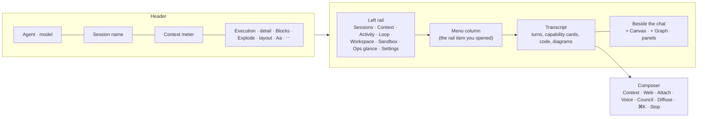

# 50 · Chat UI

The chat is where most work in Vera starts: you talk to an agent, it reads the
context Vera assembles for it, calls capabilities, and its answers can be sent on
to the canvas, a report, a podcast, a notebook or another channel. This guide is a
tour of the **interface** — every control on the screen and what it does. How a
turn is routed, how context is assembled and how replies stream are covered in
[19 · Agents & Chat](./19-agents-chat.md).

The chat is served at `/chat_panel` and also runs as a panel inside the main
shell. A link with `?session_id=<id>` opens that session directly.

## Contents

- [1. The screen at a glance](#1-the-screen-at-a-glance)
- [2. The header](#2-the-header)
- [3. The left rail and its menus](#3-the-left-rail-and-its-menus)
- [4. The Context menu](#4-the-context-menu)
- [5. The composer](#5-the-composer)
- [6. Slash commands](#6-slash-commands)
- [7. Messages and what you can do with them](#7-messages-and-what-you-can-do-with-them)
- [8. Code, HTML and diagrams in replies](#8-code-html-and-diagrams-in-replies)
- [9. Reading modes: detail, blocks and Explode](#9-reading-modes-detail-blocks-and-explode)
- [10. Beside the chat: the canvas, the graph and panels](#10-beside-the-chat-the-canvas-the-graph-and-panels)
- [11. Execution modes: direct, DAG and the agentic loop](#11-execution-modes-direct-dag-and-the-agentic-loop)
- [12. Choosing the agent, model and capabilities](#12-choosing-the-agent-model-and-capabilities)
- [13. Where answers go](#13-where-answers-go)
- [14. Sessions](#14-sessions)
- [15. Keyboard](#15-keyboard)
- [Screenshots](#screenshots)

## 1. The screen at a glance

- **Header** — who is answering, the session, how full the context window is,
  and the switches that change how the transcript reads.
- **Left rail** — eight entries, each opening a menu column beside the
  transcript.
- **Transcript** — your turns and the agent's, with every capability call shown
  as a card while it runs.
- **Composer** — the message box with its chips, the command palette and Stop.

## 2. The header

| Control | What it does |
|---|---|
| Agent and model | The agent answering, with its model and node beneath. |
| Session name | Click to rename the session; **Name** auto-names it from the conversation. |
| Context meter | How much of the model's context window the next turn will use. |
| Execution behaviour | **Ask first** or **Auto-loop**: whether the agent asks before acting. |
| Context and tool integrations | **Caps**, **Panels**, **Web** — what the agent may reach. |
| Audio I/O | **TTS** reads replies aloud; **Mic** for voice input. |
| Special agent modes | **Council** and **Diffuse** (see [the composer](#5-the-composer)). |
| Save chat | **+ Notebook** and **+ File**. |
| Detail level | **Full** shows everything; **Hover** shows a turn's chrome when you point at it; **Zen** keeps the words, the output and the time. |
| **Blocks** | The per-turn backgrounds and rules; off is a flatter, quieter transcript. |
| **Explode** | Pulls the transcript apart into layers: what each turn read on the left, what it produced on the right. |
| Panel layout | **Min** or **Menu**. |
| **+ Canvas** / **+ Graph** | Open a section beside the chat — the tri-page, with the columns you pick. |
| **Aa** | Appearance — theme, style pack, level of detail. |
| **⋯** | All chat tools the header keeps out of the way. |

## 3. The left rail and its menus

The rail runs down the left edge. Each entry opens its menu in a column beside
the transcript, and each menu has one action at its foot; the **‹** at the top
of a menu folds it back to the rail. **☰** at the top lists every menu and what
is open now.

| Rail entry | What it holds | Action at the foot |
|---|---|---|
| **Sessions** | Past conversations, newest first — picking one loads its transcript. **Title all** auto-titles every un-named chat with the light naming model. | Start a new session |
| **Context** | What the agent is using for this turn — records, agent, skills, ontologies and capabilities — with its size meter, and the memory graph. See [the Context menu](#4-the-context-menu). | Grow it into the full context graph |
| **Activity** | What is running: the DAG of capability calls the turn made, and the monitor stream of events. | Clear the monitor |
| **Loop** | Agent loops: the current loop and its variant, the list of loop runs, and goals. | Open the loop settings |
| **Workspace** | What is open beside the chat: any registered UI panel, and the browser. | Open a panel beside the chat |
| **Sandbox** | This session's code sandbox: its status and the code it holds. | Open its terminal |
| **Ops glance** | The capabilities available to the agent, with their count. | Reload them |
| **Settings** | The agent in use and its options. | Open the full Settings page (**⌘,**) |

## 4. The Context menu

The Context menu shows what goes into the prompt with your next message, and
lets you change it. Its views:

| View | Shows |
|---|---|
| **Graph** | Layerable context sources on one plot. **Expand to the full graph** grows it. |
| **List** | The combined context, grouped by source. |
| **Fabric** | Fabric records only. |
| **Raw** | The assembled system prompt, exactly as it is sent. |
| **Frames** | Saved context frames — snapshots you can reload. |
| **⚙** | Context sources, injection and retrieval settings. |

Sources you can layer on or off: **Vec** (vector similarity), **Neo** (the
Neo4j graph), **Mem** (memory recalls), **Fab** (fabric datasets), **Web**,
**Caps** (capabilities), **Runs** (observed capability runs — non-authoritative),
**Skills**, **Ont** (ontologies), **Q&A** (related question-and-answer, second
order), **World** (Worldview latent-space neighbours and rollout) and **Agent**.
**⟳ Ctx** refreshes the whole assembly. The meter's bands can be pressed to show
or hide that source on the graph.

Retrieval settings include **Session memory** (inject the agent-maintained
session note each turn), **Entities** (crawl the fabric for records sharing
entities with the top hits), **Worldview** (needs a trained model), **Rollout**
(also pull records from the predicted next concepts), **Web search** and
**News** (both opt-in, off by default), and **All datasets**, which can restrict
fabric retrieval to a single dataset.

## 5. The composer

| Chip | What it does |
|---|---|
| **Context** | What goes in with this message — opens the Context menu. |
| **Web** | Web search before answering. |
| **Attach** | Paste or drop text, code or logs; each becomes a card in the message. |
| **Voice** | One press opens a spoken conversation; a pause sends; press again to end it. With **Speak replies**, GPU text-to-speech reads the reply as it streams — press the mic to interrupt. |
| **Council** | The same message to several instances at once. |
| **Diffuse** | The composer becomes an image prompt. |

Beside the box: **⌘K** opens the command palette (search panels, set up DAGs,
fabric sources and dreams), and **Stop** stops all running streams and agentic
loops (also **Escape**). **↓ Latest** jumps back to the newest message.

## 6. Slash commands

Type `/` in the composer. Commands run in the browser; aliases in brackets.

| Command | Argument | What it does |
|---|---|---|
| `/find` (`/search`, `/palette`, `/menu`, `/k`) | query | Command palette — search panels, agents, settings, capabilities |
| `/attach` (`/file`, `/upload`) | | Attach images, documents or code to the next message |
| `/new` (`/create`) | thing | Create a DAG, fabric source or dream |
| `/dag` | goal | Set up or build a DAG workflow |
| `/flow` (`/builder`) | | Open the visual DAG flow builder |
| `/graph` (`/fabricgraph`) | | Query fabric records via the graph |
| `/explode` (`/xp`) | path, record, node or passage | Explode something into a structured diagram — blank for the last message |
| `/fabric` (`/source`) | url | Add a data-fabric source |
| `/dream` (`/think`) | subject | Create a dream / thinking loop |
| `/panel` (`/open`) | panel | Open a UI panel |
| `/close` | | Close the open panel |
| `/agent` | agent | Switch the active agent |
| `/toggle` (`/set`) | toggle | Flip a setting on or off |
| `/cap` (`/run`, `/exec`) | capability | Execute a capability directly |
| `/vera` (`/director`) | message | Talk to Vera's director, which can orchestrate dreams, loops and projects |
| `/canvas` (`/board`, `/whiteboard`) | title, id or `list` | Embed a live canvas in the conversation (blank = the most recent; a title creates one) |
| `/help` | | List the slash commands |

## 7. Messages and what you can do with them

Every message carries its actions under **⋯**; the common ones also sit on the
message itself.

| Action | What it does |
|---|---|
| **✎ Edit** | Edit and resubmit — rewinds the chat from here. |
| **↻ Resend** | Resubmit unchanged — rewinds the chat from here. |
| **Copy** | Copy the message text. |
| **Explode** | Explode the message into a structured diagram — its code or its prose. |
| **+ Notebook** | Save it as a cell in a notebook. |
| **+ IDE** | Save it to a file via the IDE. |
| **+ Project** | Add it to a project (or a new one) in the dream system. |
| **💭 Think later** | Mark it for a dream thinking-loop Vera revisits when idle. |
| **🎤 Podcast** | Turn it into a spoken, multi-voice podcast episode. |
| **🖼 As HTML** | Re-deliver it as a self-contained HTML report (themed document, Mermaid, infographics). |
| **⇆ Re-deliver** | Send it through another channel (podcast, email, Telegram, notebook…) — the original is untouched. |
| **★ Save to gallery** | Save an artifact to the Artifacts gallery. |

Capability results render as cards. A card's record can be **pinned to the
canvas**, opened **at XL**, shown in **another form** over the same data,
**popped out** to float over the UI, or inserted **to chat**.

## 8. Code, HTML and diagrams in replies

Fenced code in a reply gets its own toolbar: **Preview JS** renders in a
sandboxed frame with the console captured; **▶ Run** executes on the Vera host
and shows the output inline (the exec sandbox applies); **⇩ Save** saves it to
the session's artifact directory; **Copy**; and **Explode** turns code into a
diagram of its symbols, calls, imports and lint.

An HTML item — or a code block that is a whole page — can be rendered **here**
in a sandboxed frame (no network, no cookies, no reach into the page), in the
larger **Pane**, or **popped out**. Whether HTML items draw themselves or show
their source by default is a setting; each item keeps its own switch.

## 9. Reading modes: detail, blocks and Explode

- **Full · Hover · Zen** — how much of each turn's chrome is shown.
- **Blocks** — per-turn backgrounds and rules on or off.
- **Explode** — the transcript pulled apart into layers, what each turn read on
  the left and what it produced on the right, as **Cards** (every pane as layer
  cards), **Front** (the layers pulled apart in depth) or **Iso** (the layers
  across an isometric plane).

## 10. Beside the chat: the canvas, the graph and panels

**+ Canvas** and **+ Graph** open columns beside the transcript. The canvas is a
live document chat and loops render into; **✦ enrich** brings forward what else
is relevant after each reply — dashboard reads, news, web results, fabric
records — as widgets beside it, without calling a model. **COLS** pins the
number of columns on the stage, or **auto** reads the width. **Runs** draws the
runs between the turns and the items they made or read.

Any panel can be opened beside the chat from **Workspace → Panels**, `/panel`,
or the command palette; **Drag to resize** moves the split.

## 11. Execution modes: direct, DAG and the agentic loop

| Mode | What happens |
|---|---|
| Direct | The agent answers, calling capabilities as it goes. |
| **DAG** | The agent plans a multi-step workflow before executing. **Step** switches one-shot or stepwise DAG execution. |
| **Loop** | The agentic loop plans and executes capabilities one step at a time; its live graph is under **Loop** in the rail. |

**⚙ Config** opens the loop's settings — the engine variant, budgets, triage,
human-in-the-loop approval, recovery and branching, model and instance
overrides. Each field carries its own explanation; the engines themselves are
described in [03 · DAG & Loop Engine](./03-dag-engine.md).

## 12. Choosing the agent, model and capabilities

The agent picker sets the **active agent** for the session and the **default
agent** for new sessions. **Model override** and **Ollama instance override**
replace the agent's configured model or node for this session. **Output
format** appends a shared output-format directive to the system prompt.

**Override** enables a session capability override independent of the agent's
domain capabilities: pick **All**, **None**, or per group **On/Off**; **Revert**
returns to the agent's configuration and **Save to agent** persists the
selection as the agent's capabilities.

## 13. Where answers go

The chat always shows the answer. A delivery setting decides where a finished
answer **also** goes: the chat only, a fixed channel, or **Let the model
choose** — a small model (off the GPU) decides whether the canvas, a report, a
podcast or a note would serve better, and most answers stay in the chat alone.
Another setting picks where HTML reports show (on the canvas or in a new tab).

## 14. Sessions

Sessions live under **Sessions** in the rail. Click the name in the header to
rename one, or **Name** to auto-name it; **Title all** names every un-named
chat. Open a specific session with `/chat_panel?session_id=<id>`.

## 15. Keyboard

| Keys | Does |
|---|---|
| `⌘K` / `Ctrl K` | Command palette |
| `⌘,` | The Settings page |
| `Escape` | Stop all running streams and loops; closes an open dialog |
| `/` | Slash commands in the composer |

## Screenshots

<!-- VERA:AUTO:screenshots START -->
_No screenshots captured yet — run `docs.build` (or `operator.mission.run documentation`)._
<!-- VERA:AUTO:screenshots END -->

## Capabilities

<!-- VERA:AUTO:capabilities START -->
_No capabilities resolved for this domain._
<!-- VERA:AUTO:capabilities END -->

## See also

- [19 · Agents & Chat](./19-agents-chat.md) — routing, context assembly, streaming
- [03 · DAG & Loop Engine](./03-dag-engine.md) — the DAG and agentic-loop engines
- [05 · Memory Graph](./05-memory-graph.md) and [06 · Data Fabric](./06-data-fabric.md) — where context comes from
